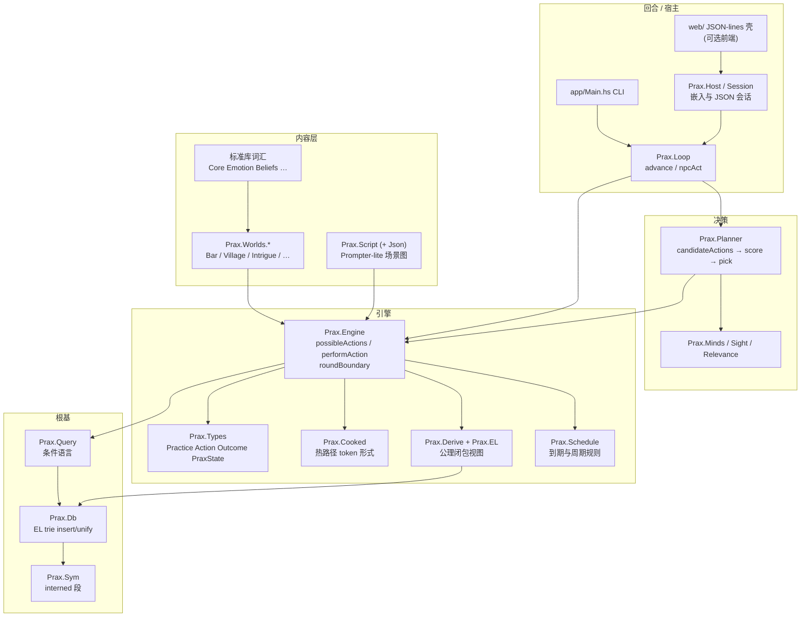

# Prax 代码设计与架构

面向阅读源码与扩展世界的总览。特性时间线与验收细节见 [`LEDGER.md`](LEDGER.md)；玩法导览见 [`WALKTHROUGH.md`](WALKTHROUGH.md)；系统级意图见 [`PRINCIPLES.md`](PRINCIPLES.md)。Rust 并行引擎的实现契约另见 [`rewrite/ARCHITECTURE.md`](rewrite/ARCHITECTURE.md)（那是 rewrite 程序的裁定记录，不是本文的替代品）。

本文描述的是仓库里 **Haskell 参考实现**（`src/Prax/`、`app/`）的分层与数据流；模块名与函数名均来自当前源码，不臆造 API。

---

## 1. 设计目标

Prax 用 Haskell 重实现 **Versu**（Evans & Short 的模拟主义叙事系统）的核心，并自 **Praxish**（对 Praxis 语言的 JS 理性重建）向上生长。引擎侧目标可以压成四条：

1. **排他逻辑（Exclusion Logic）世界** — 世界状态是带 `.` / `!` 的句子 trie（`Prax.Db`），查询与插入保留论文语义；纠正 Praxish `db.js` 里会丢数据的 `!` 插入。
2. **社会实践提供 affordance，不命令 agent** — 实践（`Practice`）向参与者抛出可选动作；谁做、做不做，由角色或玩家决定（对齐 Versu「实践建议、agent 决策」）。
3. **效用式自主选择** — `Prax.Planner` 对候选做 apply-and-evaluate；前瞻是对被相信心智的回合漫步（v23），不是全知、也不是把他人从不采取的动作记在其账上。
4. **世界即内容包** — `Prax.Worlds.*` 用同一 eDSL 组装实践、角色、公理与调度；引擎不内嵌某一故事。标准库模块（`Core`、`Witness`、`Rumor`、…）只提供可复用约定，由世界选择接线。

时间尺度另有系统原则：**默认一回合 ≈ 5 分钟虚构时间**（见 `PRINCIPLES.md`）。测试压缩必须标明，不得把压缩常量说成语义基线。

---

## 2. 分层总览



自上而下的依赖方向是：**内容 → 回合循环 → Planner → Engine → Query → Db**。内容层不得反向依赖 CLI/web；标准库不持有某一已发布世界的专属剧情（例：`Prax.Reactions` 自 v48 起不再携带酒吧专用内容）。

---

## 3. 关键模块职责

| 模块 | 职责（一句话） |
|------|----------------|
| `Prax.Sym` | 段名 interning；热路径用 `Sym`，边界用 `String` |
| `Prax.Db` | 排他逻辑 trie：`insert` / `retract` / `unify` / `ground`；纠正后的 `!` 语义 |
| `Prax.EL` | Exclusion Logic 格运算（`meet` / `leq`），支撑派生与矛盾 `⊥` |
| `Prax.Query` | 叠在 unify 上的条件 ADT（Match、Not、Eq、数值、Or/Absent/Exists、…） |
| `Prax.Types` | `Practice` / `Action` / `Outcome` / `Character` / `Want` / `PraxState` 等核心类型与 eDSL 默认值 |
| `Prax.Cooked` | 创作表面 → 预切分 token 形式，供热路径 |
| `Prax.Engine` | 注册实践、发现 affordance（`possibleActions`）、执行（`performAction`）、实践孵化 + `init`、回合边界 |
| `Prax.Derive` | 前向链公理；`readView` 可废止闭合视图（派生不持久化） |
| `Prax.Planner` | `candidateActions` → `scoreActions` / `pickAction`；apply-and-evaluate + 信念心智前瞻 |
| `Prax.Minds` / `Sight` / `Relevance` | 可命名欲望与被相信动机；地点目击；相关性/活性剪枝 |
| `Prax.Loop` | 轮转 `advance`、NPC `npcAct`（意图承诺）、`runNpcTicks` |
| `Prax.Schedule` | 周期规则与到期（与 `InsertFor`、`roundBoundary` 协作） |
| `Prax.Host` / `Session` / `Persist` | 宿主嵌入步进、会话 JSON、存档读档 |
| `Prax.Script` (+ `Script.Json`) | 场景图编译为普通实践 + 引擎调度规则 |
| `Prax.TypeCheck` / `Inspect` / `Stress` / `Chronicle` | 静态检查、解释不可用动作、压力轨迹、只读显著性查询 |
| `Prax.Worlds.*` | 可玩内容包：组装实践、角色、公理、调度与初始事实 |
| `app/Main.hs` | CLI：世界选择、菜单、`stress` / `check` / `flow` 等工具子命令 |

**标准库（约定，非新语义）：** `Core`（关系分）、`Emotion`、`Beliefs`、`Conversation`、`Reactions`、`Deontic`、`Witness`、`Rumor`、`Repute`、`Deceit`、`Project`、`Persona`、`Debt` / `Blackmail` / `Coerce`、`Faction` / `Kin`、`Confession`、`Arc` 等——在 `Engine` 之上用普通句子与实践组合表达 Versu「核心模型」与后续扩展；世界显式接线后才生效。

**旁支实现：**

| 路径 | 角色 |
|------|------|
| `conformance/` | 语义账本：`HASKELL_PINS.txt`、fixtures、goldens、`KILLED.md`（原跨实现对照残留） |
| `web/` | 「我的小镇」等网页壳：经 JSON-lines 调 `Prax.Session`，不复制引擎语义 |

---

## 4. 一回合的数据流

玩家或 NPC 的一次行动，核心路径如下（名称对齐源码）：

```text
1. Loop.advance
     选下一存活角色；若轮转回绕 → Engine.roundBoundary
     （推进时钟、触发到期 / 周期调度规则）

2. 发现 affordance
     Engine.possibleActions st actorName
       · 扫描活跃 practice 实例（db 中 practice.<id>…）
       · 用煮熟前置对闭合视图求值，得到 GroundedAction 列表
     Planner.candidateActions
       · 死者 → []
       · 若 Character.charBoundTo = Just pid，则只保留该实践
       （玩家即 DM / 点唱机等绑定槽位靠此过滤）

3. 选择
     人类：CLI / Host / Session 展示菜单，选一条 GroundedAction
     NPC：Loop.npcAct
       · 若站立 Intention 的 MotiveSignature 未变且动作仍被提供 → 直接执行承诺
       · 否则 Planner.pickAction（内部 scoreActions）
         - 对每个候选 performAction 到丢弃用的 fork 状态
         - evaluate / evaluateCooked：Σ utility × 满足计数
         - 前瞻：predictionScope 内他人按被相信欲望 predictMove（折扣 0.5）
           再递归自身下一步（折扣 0.9）

4. 执行
     Engine.performAction st ga
       · 应用动作的 Outcome（Insert / Delete / InsertFor / Call / ForEach / Roll）
       · Insert 路径上若新出现 practice 实例 → 孵化并跑该实践的 initOutcomes 一次
       · 维护派生视图（v27 三层：无关 delta / 单调插入延续 / 否则全量 reclose）

5. 后续涌现（内容决定，非引擎硬编码）
     结果可能插入反应实践、义务、信念、情感等句子；
     下一批 possibleActions 自然变多或变少——实践仍然只「建议」。
```

确定性：planner 与 RNG（`Prax.Rng`）在播种后可复现；`runNpcTicks` 用于金标准旁白轨迹。意图机制见规格 `docs/specs/2026-07-13-v35-intentions.md`；调度见 `docs/specs/2026-07-16-v44-the-schedule.md`。

---

## 5. 重要不变量

下列条目是读代码与写世界时最容易踩破的约束（细节散落在模块头注释与 `PRINCIPLES` / 规格中）：

1. **`!` 排他** — 同一父节点单值槽；新 `!` 插入清掉互斥兄弟，但按论文规则保留应保留的子树。查询对 `.` / `!` 同等对待，**排他标志留在 trie 里**，供 `Prax.EL.meet` 检测矛盾。
2. **断言标志** — 节点可「仅作脚手架」或「自身被断言」；trie **从不保留未断言的无子节点**（v39）。
3. **实践建议，不命令** — 实践与 story-manager-as-practice 只改变事实与可用 affordance；强制剧情应写成欲望/义务/场景 junction，而不是在引擎里硬编码「下一句必须说」。
4. **role ≠ character** — 实践角色是变量槽；阵容里的 `Character` 可经 casting 填入。绑定（`charBoundTo`）是显式限制，不是默认。
5. **派生视图可废止** — 公理结论活在 `readView`，不写回基事实；撤回前提即消解结论。道义 `□` 闭包是世界选择加入的创作声明（`Prax.Deontic.obligedClose`），不是引擎偷加的规则。
6. **热路径走煮熟形式** — 世界构建时 `retable` 煮实践/公理/wants；运行时候选枚举与结果应用走 `Cooked*`，字符串求值器保留为参考。
7. **枚举确定性** — unify 未绑定分支、`childKeys`、句子枚举等按 **名称序**，不按 intern id 遭遇序泄漏到候选顺序。
8. **一回合 ≈ 5 分钟** — 真实世界内容按此设计；测试压缩必须在常量旁标明真尺度（`PRINCIPLES.md`）。
9. **词汇拒绝伪造世界真值** — 欺骗/谎言种的是信念与出处边，不设「引擎级真相日志」来洗清嫁祸（见 Village / Deceit 设计承诺）。

---

## 6. 世界 / 内容包如何接到引擎

典型组装（以 `Prax.Worlds.Bar` 为形，其他世界同构）：

```text
emptyState
  → definePractices [worldP, greetP, …]     -- 登记实践定义 + dataFacts
  → defineFunctions […]                    -- 可选守卫函数
  → setCharacters […]                      -- wants / desires / boundTo
  → setSchedule […]                        -- 如 Sight.sightRule
  → setAxioms […]                          -- 如有派生世界
  → performOutcome / 批量 Insert            -- 初始地点、关系、实践实例
  → seedDie …                               -- 若使用 Roll
```

`Prax.Script.compile` 把 CAST + 场景图编译成 **普通实践** 外加 **安静的引擎调度规则**（v46 起不再用无身体 narrator 角色假动作）。JSON 往返在 `Prax.Script.Json`；CLI：`prax flow`、`prax play examples/play.json`。

已发布世界目录（`src/Prax/Worlds/`）包括但不限于：`Bar`、`Intrigue`、`Play`、`Audience`、`Feud`、`Village`、`Sandbox`、`MyTown` 等——各自演示账本中不同切片；引擎核心不因多一个世界而分叉。

---

## 7. web / conformance 在仓库中的位置

```text
Prax/
├── src/Prax/          # Haskell 参考引擎 + 世界（语义源）
├── app/Main.hs        # CLI
├── test/              # 规格钉与世界测试
├── docs/              # 原则、账本、导览、plans/specs、本文
├── conformance/       # 语义钉与金标准簿记
├── examples/          # 可编辑剧本 / 会话样例 JSON
└── web/               # 可选 UI 壳（Session JSON-lines；勿在此复刻规则）
```

- **改语义**：先改 Haskell + `test/` + 必要时 `docs/specs/`。
- **改故事**：优先只动 `Prax.Worlds.*` 或 `examples/*.json`；能下沉为可复用组合子时再进标准库模块。
- **改 UI**：只消费 `Host` / `Session` 已暴露字段；行为争议以引擎测试为准。

---

## 8. 相关文档索引（避免重复账本）

| 文档 | 何时打开 |
|------|----------|
| [`PRINCIPLES.md`](PRINCIPLES.md) | 回合时间尺度等系统级意图 |
| [`LEDGER.md`](LEDGER.md) | 「某能力在哪一版、是否做完」 |
| [`WALKTHROUGH.md`](WALKTHROUGH.md) | 边玩边对照特性 |
| [`research/versu-notes.md`](research/versu-notes.md) | Versu 论文架构摘记 |
| [`research/praxis-praxish-notes.md`](research/praxis-praxish-notes.md) | EL + Praxish 对照 |
| [`research/deon-notes.md`](research/deon-notes.md) | 道义逻辑背景 |
| [`specs/`](specs/) / [`plans/`](plans/) | 单特性设计与实现计划 |
| [`rewrite/ARCHITECTURE.md`](rewrite/ARCHITECTURE.md) | Rust 引擎实现契约 |

维护建议：模块职责或主数据流变更时更新本文；版本流水账只追加 `LEDGER.md`。
